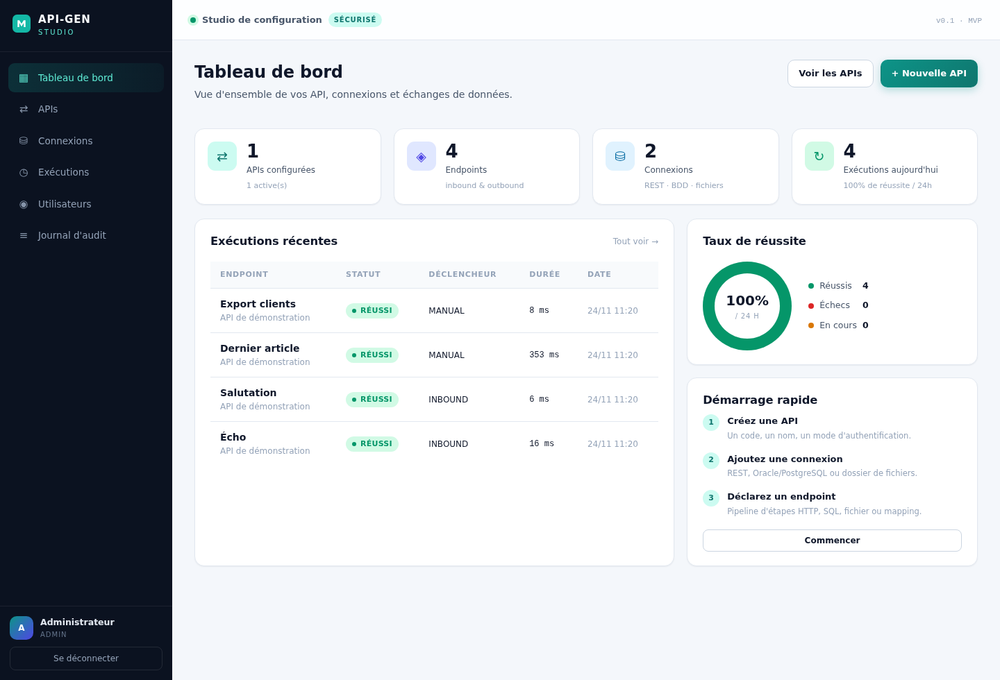
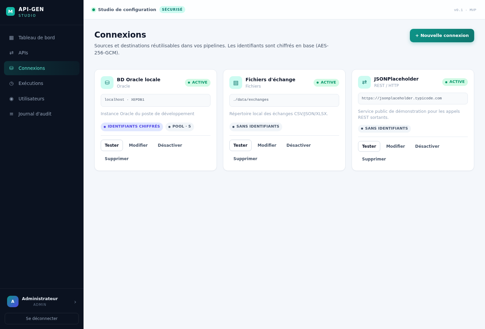
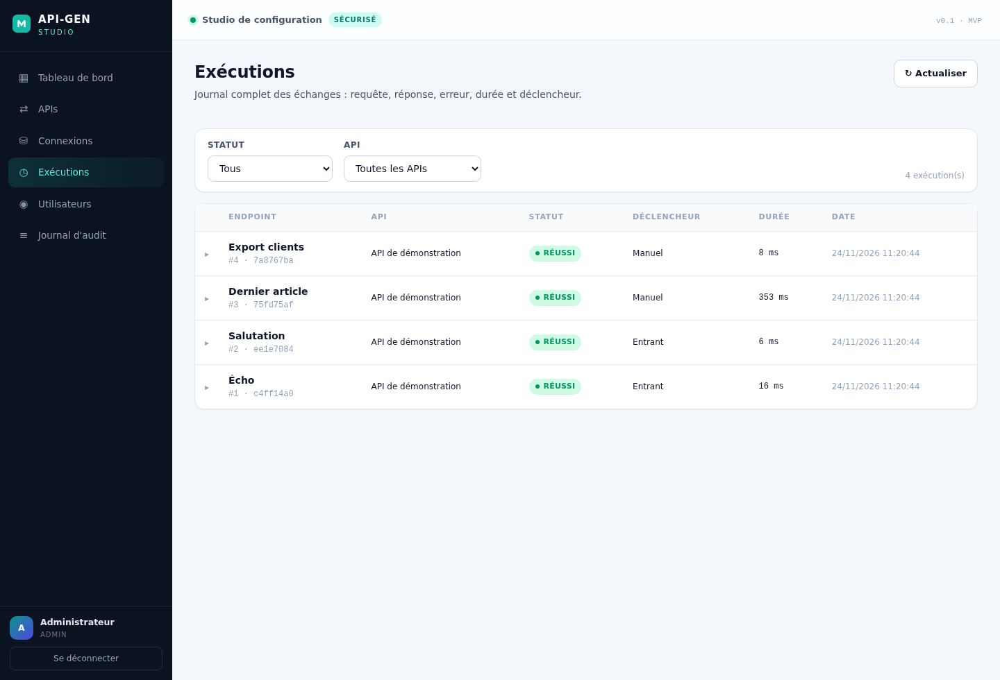
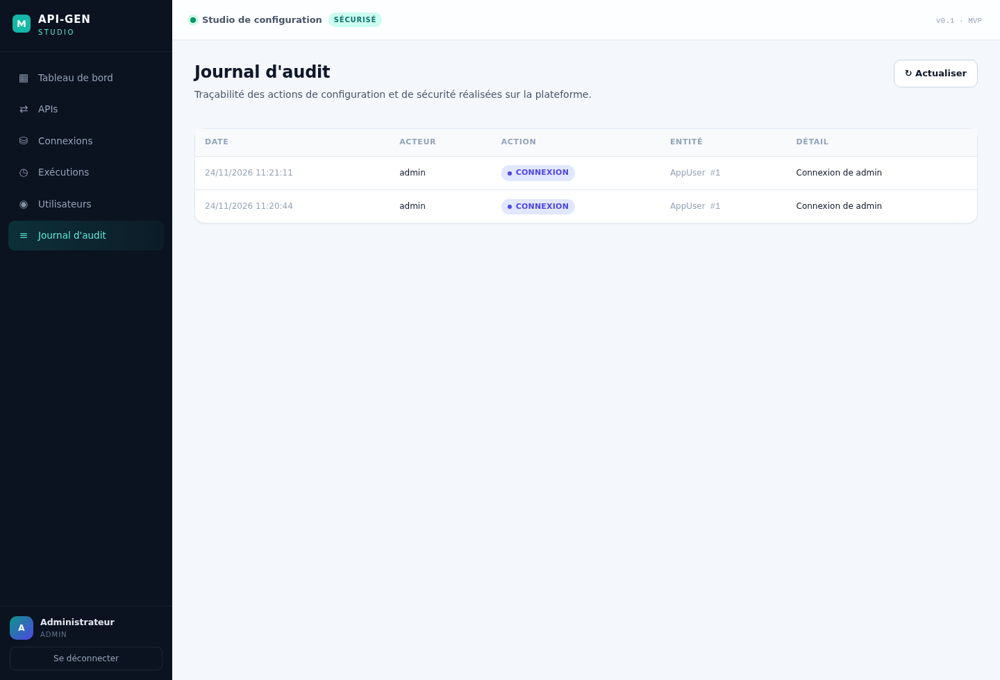
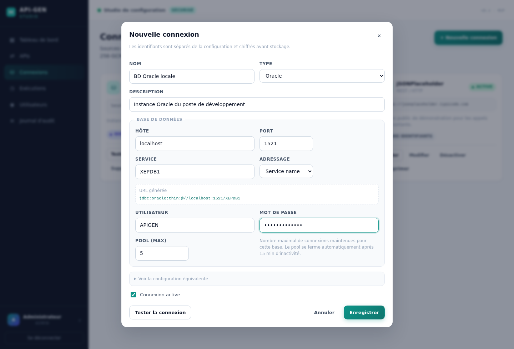
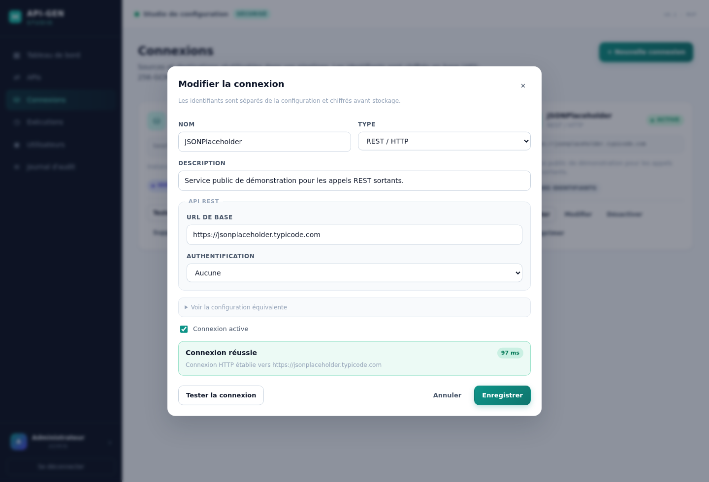
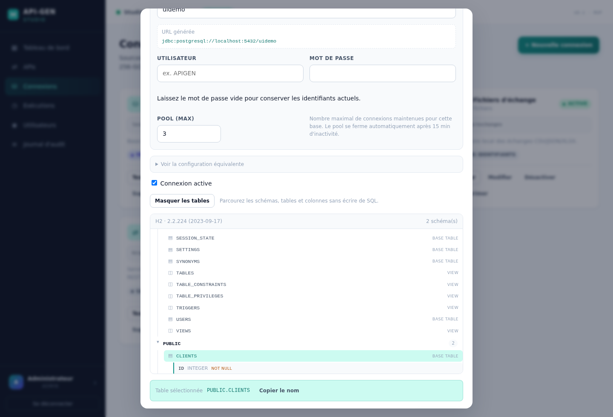
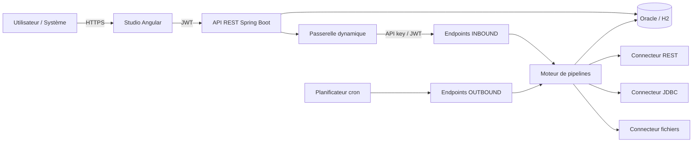

# API-GEN-AUTO

**Studio d'usine à API** : configurez des interfaces sécurisées et paramétrables pour l'échange automatique de données entre vos systèmes — sans écrire de code.

Le projet répond à un besoin concret d'entreprise : plutôt que de développer une API sur mesure pour chaque intégration, l'équipe déclare **une API**, ses **endpoints**, ses **connexions**, son **mapping de champs** et sa **planification** depuis une interface graphique. Un moteur d'exécution exécute ensuite les pipelines REST, SQL ou fichiers, journalise chaque échange et applique les règles de sécurité.

> **Statut** : MVP fonctionnel de bout en bout (backend Spring Boot + studio Angular). Prêt à être durci pour la production.

---

## Aperçu

| Login | Tableau de bord |
| --- | --- |
|  |  |

| APIs | Éditeur d'API |
| --- | --- |
|  |  |

| Connexions | Exécutions |
| --- | --- |
|  |  |

| Journal d'audit | Profil & mot de passe |
| --- | --- |
|  |  |

| Formulaire de connexion | Test avec latence |
| --- | --- |
|  |  |

| Explorateur de schémas | Génération d'étape depuis une table |
| --- | --- |
|  |  |

---

## Fonctionnalités du MVP

### Studio d'administration
- Tableau de bord : volumes, taux de réussite, exécutions récentes.
- CRUD complet des **APIs**, **endpoints**, **connexions** et **utilisateurs**.
- Assistant de configuration : informations générales, sécurité, endpoints, pipeline, planification, test.
- **Explorateur de base** : schémas → tables → colonnes (nom, type, nullabilité), sans écrire de SQL.
- **Génération d'étape** : sélectionner une table dans l'explorateur ajoute automatiquement une étape `DB_QUERY` au pipeline.
- Journal des **exécutions** avec requête, réponse, erreur, durée, déclencheur.
- **Journal d'audit** des actions de configuration et de sécurité.
- Gestion des rôles : `ADMIN`, `EDITOR`, `VIEWER`.

### Moteur d'exécution
- Endpoints **INBOUND** exposés par une passerelle dynamique : `/api/gateway/{code-api}{chemin}`.
- Endpoints **OUTBOUND** exécutables manuellement ou planifiés par cron (format Spring, 6 champs).
- Pipelines JSON composés d'étapes ordonnées :
  - `HTTP` / `REST` : appels sortants (GET, POST, PUT, PATCH, DELETE) avec auth Basic, Bearer ou API key.
  - `DB_QUERY` : lecture Oracle, PostgreSQL, MySQL, SQL Server (JDBC).
  - `DB_EXEC` : écriture / mise à jour / procédure.
  - `FILE_READ` / `FILE_WRITE` : CSV, JSON, XLSX (système de fichiers local, protection contre le path traversal).
  - `MAP` : mapping de champs avec transformations (`UPPER`, `LOWER`, `TRIM`, `TO_INT`, `TO_DOUBLE`, `TO_BOOLEAN`, `CONCAT`, `DATE_FORMAT`…).
  - `SET` et `LOG` pour les variables et la traçabilité.
- Templates `{{chemin.dotted}}` : `request.body.client`, `request.query.id`, `payload`, `steps.0`, `output`.
- Journalisation de chaque exécution avec résumé de requête/réponse et durée.

### Sécurité
- Authentification **JWT** pour le studio (expiration configurable, BCrypt pour les mots de passe).
- **Clés API** par API (header `X-API-Key`), stockées uniquement sous forme de hash SHA-256.
- Mode **JWT** pour les endpoints entrants.
- Identifiants des connexions **chiffrés en base** (AES-256-GCM) et jamais renvoyés par l'API.
- RBAC sur les endpoints d'administration, CORS configurable, headers de sécurité.
- Journal d'audit horodaté (acteur, action, entité, détail).

---

## Architecture



**Stack**

| Couche | Techno |
| --- | --- |
| Backend | Java 17, Spring Boot 3.3, Spring Security, Spring Data JPA |
| Frontend | Angular 17 (standalone, signals), TypeScript 5.4, SCSS |
| Base | Oracle 12c+ (prod) / H2 en mode Oracle (dev) |
| Migrations | Flyway |
| Chiffrement | AES-256-GCM (identifiants), BCrypt (mots de passe), SHA-256 (clés API) |
| JWT | jjwt 0.12 |
| Fichiers | OpenCSV, Apache POI |
| Docs API | springdoc-openapi (Swagger UI) |

### Structure

```
API-GEN-AUTO/
├── backend/                    # Spring Boot
│   ├── src/main/java/com/apigen/
│   │   ├── config/             # sécurité, scheduling, seed
│   │   ├── domain/             # entités JPA
│   │   ├── repository/
│   │   ├── service/            # CRUD + moteur d'exécution
│   │   │   └── connector/      # REST, JDBC, fichiers
│   │   ├── execution/          # contexte, templates, étapes
│   │   ├── web/                # contrôleurs + passerelle
│   │   └── dto/
│   ├── src/main/resources/db/migration/V1__init.sql
│   └── Dockerfile
├── frontend/                   # Angular
│   ├── src/app/core/           # services, guards, interceptors
│   ├── src/app/features/       # login, dashboard, apis, connexions, runs…
│   ├── src/app/shell/
│   ├── nginx.conf
│   └── Dockerfile
├── docs/screenshots/
├── .github/workflows/ci.yml
├── docker-compose.yml
└── Makefile
```

---

## Démarrage rapide (développement)

### Prérequis
- Java 17+
- Maven 3.9+
- Node.js 20+ et npm

### 1. Backend (H2, zéro configuration)

```bash
cd backend
mvn spring-boot:run -Dspring-boot.run.profiles=dev
```

- API : `http://localhost:8080`
- Swagger : `http://localhost:8080/swagger-ui.html`
- Console H2 : `http://localhost:8080/h2-console`
- Compte admin créé au premier démarrage : **admin / ChangeMe123!**

### 2. Frontend

```bash
cd frontend
npm install
npm start
```

Studio : `http://localhost:4200` (le proxy Angular redirige `/api/` vers `http://localhost:8080`).

### 3. Utiliser la démonstration

Le profil `dev` crée une API `demo` avec quatre endpoints :

| Méthode | Chemin | Rôle |
| --- | --- | --- |
| `POST` | `/api/gateway/demo/echo` | Répond le message reçu en majuscules |
| `GET` | `/api/gateway/demo/hello?name=Amina` | Salutation avec mapping |
| `GET` | `/api/gateway/demo/posts` | Appel REST sortant + mapping (JSONPlaceholder) |
| `POST` | `/api/gateway/demo/export/clients` | Écriture CSV |

Exemple :

```bash
curl -X POST http://localhost:8080/api/gateway/demo/echo \
  -H "Content-Type: application/json" \
  -d '{"message":"bonjour"}'
```

```json
{"runId":1,"correlationId":"bd69b4cd","status":"SUCCESS","data":{"echo":"BONJOUR","receivedVia":"POST"}}
```

---

## Se connecter à votre Oracle local

Le studio peut dialogiquer avec n'importe quelle base Oracle accessible depuis la machine qui exécute le backend — y compris celle installée sur votre poste de développement. Rien à changer dans la configuration Spring : tout se fait dans l'interface.

### 1. Vérifier que l'instance écoute

```bash
lsnrctl status
```

Repérez le **service name** déclaré (par exemple `FREEPDB1` sur Oracle Free 23ai, `XEPDB1` sur XE 21c, `orcl` sur une instance non-multitenant). Si le listener n'est pas démarré :

```bash
lsnrctl start
```

### 2. Créer un utilisateur dédié

Avec SQL*Plus (ou SQL Developer) en `SYSDBA` :

```sql
-- Si l'instance est multitenant, se placer dans le PDB
ALTER SESSION SET CONTAINER = FREEPDB1;

CREATE USER APIGEN IDENTIFIED BY "ChangeMe_2026" QUOTA UNLIMITED ON USERS;
GRANT CONNECT, RESOURCE, CREATE VIEW, CREATE TABLE TO APIGEN;
```

Contrôle depuis un terminal :

```bash
sqlplus APIGEN/ChangeMe_2026@//localhost:1521/FREEPDB1
```

Si cette commande échoue, le studio échouera de la même manière : corrigez d'abord ici.

### 3. Déclarer la connexion dans le studio

**Connexions → Nouvelle connexion**, puis :

| Champ | Valeur |
| --- | --- |
| Type | `Oracle` |
| Hôte | `localhost` |
| Port | `1521` |
| Service | `FREEPDB1` (ou `XEPDB1`, `orcl`…) |
| Adressage | `Service name` (ou `SID` pour les instances anciennes) |
| Utilisateur | `APIGEN` |
| Mot de passe | votre mot de passe |
| Pool (max) | `5` |

L'URL générée s'affiche en aperçu :

```
jdbc:oracle:thin:@//localhost:1521/FREEPDB1
```

Cliquez **« Tester la connexion »** : le résultat s'affiche avec la latence mesurée. Enregistrez ensuite.

### 4. L'utiliser dans un pipeline

Deux façons :

**Sans écrire de SQL** — dans l'éditeur d'API, cliquez sur **« ⊞ Parcourir la base »** au-dessus du pipeline. Choisissez la connexion, dépliez le schéma, cliquez sur une table : la requête `SELECT * FROM SCHÉMA.TABLE` est proposée, et le bouton « Insérer l'étape DB_QUERY » l'ajoute au pipeline.

**À la main** :

```json
[
  {
    "type": "DB_QUERY",
    "name": "verif",
    "connectionId": 3,
    "sql": "SELECT sysdate AS moment FROM dual"
  }
]
```

`connectionId` est l'identifiant affiché sur la carte de la connexion. L'étape emprunte une connexion au pool, exécute la requête et la rend au pool.

### Erreurs Oracle fréquentes

| Code | Cause | Correctif |
| --- | --- | --- |
| `ORA-12541` | Aucun listener | `lsnrctl start` |
| `ORA-12505` | Le listener ne connaît pas ce SID | Passer l'adressage en `Service name`, ou corriger le SID |
| `ORA-12514` | Service name inconnu | Vérifier le nom avec `lsnrctl status` |
| `ORA-01017` | Identifiants refusés | Recréer l'utilisateur ou vérifier le mot de passe |
| `ORA-28000` | Compte verrouillé | `ALTER USER APIGEN ACCOUNT UNLOCK;` |

---

## Configuration

Copier `.env.example` vers `.env` (ou exporter les variables) :

| Variable | Défaut | Rôle |
| --- | --- | --- |
| `APIGEN_PROFILE` | `dev` | `dev` (H2) ou `prod` (Oracle) |
| `APIGEN_DB_URL` | `jdbc:oracle:thin:@//localhost:1521/FREEPDB1` | URL JDBC Oracle |
| `APIGEN_DB_USER` | `apigen` | Utilisateur Oracle |
| `APIGEN_DB_PASSWORD` | — | Mot de passe Oracle |
| `APIGEN_JWT_SECRET` | valeur de dev | **À changer en production** (≥ 64 caractères) |
| `APIGEN_CRYPTO_KEY` | valeur de dev | Clé AES-256 des identifiants (**à changer**) |
| `APIGEN_CORS_ORIGINS` | `http://localhost:4200,http://localhost:8080` | Origines autorisées |
| `APIGEN_SCHEDULER_ENABLED` | `true` | Active le planificateur cron |
| `APIGEN_SCHEDULER_POLL_MS` | `15000` | Fréquence de scrutation |
| `APIGEN_FILES_BASE_DIR` | `./data/exchanges` | Racine des fichiers |
| `APIGEN_SEED_DEMO` | `true` en dev | Crée le jeu de démonstration |
| `APIGEN_JWT_EXPIRATION_HOURS` | `8` | Durée de vie des jetons |
| `APIGEN_JDBC_POOL_EVICT_MS` | `300000` | Fréquence de fermeture des pools inactifs |

### Production avec Oracle

1. Créer un utilisateur dédié (exemple Oracle 23ai / FREEPDB1) :

```sql
CREATE USER APIGEN IDENTIFIED BY "ChangeMe_2026";
GRANT CONNECT, RESOURCE, CREATE VIEW, CREATE TABLE, CREATE SEQUENCE TO APIGEN;
ALTER USER APIGEN QUOTA UNLIMITED ON USERS;
```

2. Lancer le backend en profil `prod` :

```bash
export APIGEN_PROFILE=prod
export APIGEN_DB_URL="jdbc:oracle:thin:@//db-host:1521/FREEPDB1"
export APIGEN_DB_USER="apigen"
export APIGEN_DB_PASSWORD="ChangeMe_2026"
export APIGEN_JWT_SECRET="$(openssl rand -hex 48)"
export APIGEN_CRYPTO_KEY="$(openssl rand -base64 32)"
export APIGEN_SEED_DEMO=false
java -jar backend/target/apigen-platform.jar
```

Flyway applique automatiquement `V1__init.sql` (tables, index, contraintes). Le script est compatible Oracle 12c+ et H2 (mode Oracle).

---

## Concepts

### API
Un conteneur logique : code unique, nom, version, statut (`DRAFT`, `ACTIVE`, `PAUSED`, `ARCHIVED`), mode d'authentification entrant (`NONE`, `API_KEY`, `JWT`).

### Endpoint
Une route exposée (INBOUND) ou un flux sortant (OUTBOUND) :

- `method` + `path` (variables `{id}` acceptées),
- `pipeline` : tableau JSON d'étapes,
- `active` : interrupteur sans suppression,
- `schedule` : cron optionnel + payload JSON.

### Connexion
Une source ou destination réutilisée : REST, Oracle, PostgreSQL, MySQL, SQL Server, fichiers, FTP/SFTP (connecteurs FTP/SFTP à venir).

- `baseConfig` : JSON non sensible (`baseUrl`, `jdbcUrl`, `host`, `port`, `database`, `basePath`, `authType`…).
- `credentials` : JSON chiffré en base (`username`, `password`, `token`, `apiKey`).

Le formulaire du studio **n'exige pas d'écrire de JSON** : choisissez le type, saisissez l'hôte, le port et le service, l'URL JDBC est générée et affichée en aperçu. Les champs `host` / `port` / `database` sont enregistrés en plus de `jdbcUrl` pour que le formulaire se raffiche correctement en édition.

**Test de connexion** : le bouton « Tester la connexion » ouvre une connexion réelle et affiche le résultat avec la **latence mesurée** (< 300 ms en vert, < 1 s en orange, au-delà en rouge). Une base injoignable répond en quelques centaines de millisecondes avec le message exact du pilote JDBC (`Connection refused`, `ORA-12505`, …).

**Pool de connexions** : chaque connexion de type base de données dispose de son propre pool HikariCP, dimensionné par le champ « Pool (max) » (1 à 20, 5 par défaut). Le pool est recréé automatiquement quand l'URL ou les identifiants changent, et fermé après **15 minutes d'inactivité**. L'exécution d'une étape `DB_QUERY` réutilise ainsi une connexion déjà établie au lieu d'ouvrir une nouvelle connexion à chaque appel — sur Oracle, cela évite un handshake réseau complet par exécution.

**Découverte de la structure** : le bouton « Découvrir les tables » liste les schémas, puis les tables et vues de chaque schéma, puis les colonnes d'une table sélectionnée (nom, type, `NOT NULL`). L'explorateur est aussi disponible depuis l'éditeur d'API via « ⊞ Parcourir la base » : choisir une table génère une étape `DB_QUERY` complète avec le nom qualifié et le bon `connectionId`.

Les requêtes de métadonnées sont écrites par dialecte : `all_users` / `all_tables` / `all_tab_columns` côté Oracle (en écartant les schémas maintenus par Oracle via `oracle_maintained = 'N'`), `information_schema` pour PostgreSQL, MySQL et SQL Server. Sur **Oracle 11g**, où `ORACLE_MAINTAINED` n'existe pas, une liste d'exclusion explicite prend le relais. Un schéma illisible — faute de droits — est silencieusement omis plutôt que de faire échouer toute la découverte.

### Pipeline

```json
[
  {
    "type": "HTTP",
    "name": "appel-crm",
    "method": "GET",
    "url": "/customers/{{payload.id}}",
    "connectionId": 1,
    "headers": { "Accept": "application/json" },
    "failOnError": true
  },
  {
    "type": "MAP",
    "name": "mapping",
    "source": "output.body",
    "mappings": [
      { "source": "nom", "target": "customer.name", "transform": "UPPER" },
      { "source": "email", "target": "customer.email", "transform": "LOWER" }
    ]
  },
  {
    "type": "DB_EXEC",
    "name": "sauvegarde",
    "connectionId": 2,
    "sql": "INSERT INTO customers (name, email) VALUES (?, ?)",
    "params": ["{{output.name}}", "{{output.email}}"]
  }
]
```

#### Types d'étapes

| Type | Champs principaux |
| --- | --- |
| `HTTP` | `method`, `url`, `connectionId`, `headers`, `body`/`bodyTemplate`, `queryParams`, `timeoutMs`, `failOnError` |
| `DB_QUERY` | `connectionId`, `sql`, `params`, `maxRows`, `timeoutSeconds` |
| `DB_EXEC` | `connectionId`, `sql`, `params`, `timeoutSeconds` |
| `FILE_READ` | `connectionId`, `path`, `format` (`CSV`, `JSON`, `XLSX`) |
| `FILE_WRITE` | `connectionId`, `path`, `format`, `data` |
| `MAP` | `source`, `mappings[] {source,target,transform,default,params}`, `mode` (`REPLACE`/`MERGE`) |
| `SET` | `key`, `value` |
| `LOG` | `message` |

#### Transformations disponibles
`UPPER`, `LOWER`, `TRIM`, `TO_STRING`, `TO_INT`, `TO_LONG`, `TO_DOUBLE`, `TO_BOOLEAN`, `CONCAT` (avec `params.prefix` / `params.suffix`), `DATE_FORMAT` (avec `params.pattern`).

#### Variables
- `request.body`, `request.query`, `request.headers`, `request.pathVariables`
- `payload` (exécution manuelle ou planifiée)
- `steps.<nom>` ou `steps.<index>` (résultat d'une étape)
- `output` (dernier résultat)
- `trigger`, `vars`

---

## API REST de gestion

Toutes les routes `/api/**` (sauf `/api/auth/login` et `/api/gateway/**`) nécessitent un `Authorization: Bearer <JWT>`.

| Méthode | Route | Rôle |
| --- | --- | --- |
| `POST` | `/api/auth/login` | Connexion |
| `GET` | `/api/auth/me` | Utilisateur courant |
| `POST` | `/api/auth/change-password` | Changer son mot de passe |
| `GET/POST` | `/api/apis` | Lister / créer des APIs |
| `GET/PUT/DELETE` | `/api/apis/{id}` | Détail / mise à jour / suppression |
| `POST` | `/api/apis/{id}/api-key` | Générer / régénérer une clé |
| `DELETE` | `/api/apis/{id}/api-key` | Révoquer la clé |
| `POST` | `/api/apis/{id}/endpoints` | Créer un endpoint |
| `GET/PUT/DELETE` | `/api/endpoints/{id}` | Détail / mise à jour / suppression |
| `PATCH` | `/api/endpoints/{id}/active?active=true` | Activer / désactiver |
| `PUT` | `/api/endpoints/{id}/schedule` | Créer / mettre à jour la planification |
| `DELETE` | `/api/endpoints/{id}/schedule` | Supprimer la planification |
| `POST` | `/api/endpoints/{id}/run` | Exécution manuelle |
| `GET/POST` | `/api/connections` | Lister / créer des connexions |
| `GET/PUT/DELETE` | `/api/connections/{id}` | Détail / mise à jour / suppression |
| `POST` | `/api/connections/test` | Tester une configuration non enregistrée |
| `POST` | `/api/connections/{id}/test` | Tester une connexion enregistrée |
| `POST` | `/api/connections/discover` | Lister schémas et tables (connexion enregistrée ou inline) |
| `POST` | `/api/connections/discover/columns` | Lister les colonnes d'une table |
| `GET` | `/api/runs?apiId=&status=&page=&size=` | Journal des exécutions |
| `GET` | `/api/runs/{id}` | Détail d'une exécution |
| `GET` | `/api/dashboard` | Statistiques |
| `GET` | `/api/users` | Utilisateurs (`ADMIN`) |
| `GET` | `/api/audit` | Journal d'audit |

### Passerelle dynamique

```http
POST /api/gateway/{code-api}/{chemin}
X-API-Key: agk_...
Content-Type: application/json
```

La réponse contient toujours `runId`, `correlationId`, `status` et `data` (ou `error`).

---

## Tests

```bash
cd backend
mvn test
```

Les tests couvrent : démarrage du contexte, login JWT, protection des routes, passerelle dynamique, mapping, génération et validation d'une clé API.

---

## Docker

```bash
docker compose up --build
```

- Oracle Free : `db:1521`
- Backend : `http://localhost:8080`
- Studio : `http://localhost:4200`

Les secrets par défaut du `docker-compose.yml` sont des valeurs de démonstration : **remplacez-les** (`APIGEN_JWT_SECRET`, `APIGEN_CRYPTO_KEY`, mot de passe Oracle).

---

## Limites connues & feuille de route

- Connecteurs **FTP/SFTP** déclarés dans le modèle mais non implémentés (priorité suivante).
- La découverte de structure couvre **Oracle, PostgreSQL, MySQL et SQL Server** uniquement ; elle ne parcourt pas le réseau à la recherche de serveurs (aucun scan de ports).
- Planificateur conçu pour une **instance unique** ; prévoir ShedLock ou une table de verrous pour le multi-instances.
- Les **pools JDBC sont locaux à chaque instance** (pas de pool distribué). En cluster, chaque nœud maintient son propre pool par base cible.
- Pas de **rate limiting** ni de quota par clé API.
- Pas de **versioning** des pipelines ni de rollback.
- Studio : le pipeline reste un **éditeur JSON** (les connexions, elles, sont en champs structurés) ; un concepteur visuel par glisser-déposer est envisagé.
- Pas de **chiffrement applicatif** des réponses stockées (seuls les identifiants sont chiffrés).
- L'authentification OAuth2/OIDC côté endpoints entrants est à ajouter.
- Tests de charge et durcissement production (Helmet, CSP, rotation des clés) à compléter.

---

## Licence

Projet interne — à adapter selon la politique de votre entreprise.
