# API-GEN-AUTO

**Studio d'usine à API** : configurez des interfaces sécurisées et paramétrables pour l'échange automatique de données entre vos systèmes — sans écrire de code.

Le projet répond à un besoin concret d'entreprise : plutôt que de développer une API sur mesure pour chaque intégration, l'équipe déclare **une API**, ses **endpoints**, ses **connexions**, son **mapping de champs** et sa **planification** depuis une interface graphique. Un moteur d'exécution exécute ensuite les pipelines REST, SQL ou fichiers, journalise chaque échange et applique les règles de sécurité.

> **Statut** : MVP fonctionnel de bout en bout (backend Spring Boot + studio Angular). Prêt à être durci pour la production.
>
> **Pour installer sur votre machine** : voir [GUIDE-LOCAL.md](GUIDE-LOCAL.md) — prérequis, démarrage en 5 minutes, raccordement à Oracle et dépannage.

---

## Aperçu

| Login | Tableau de bord |
| --- | --- |
| 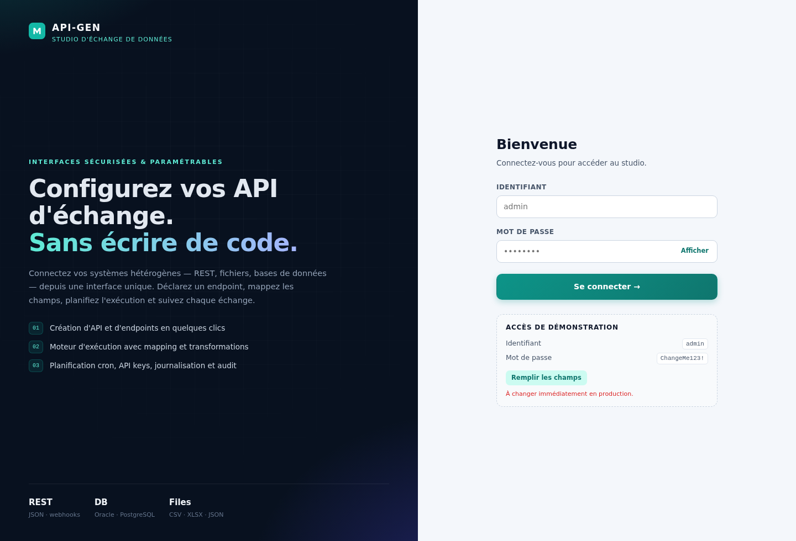 |  |

| APIs | Éditeur d'API |
| --- | --- |
| 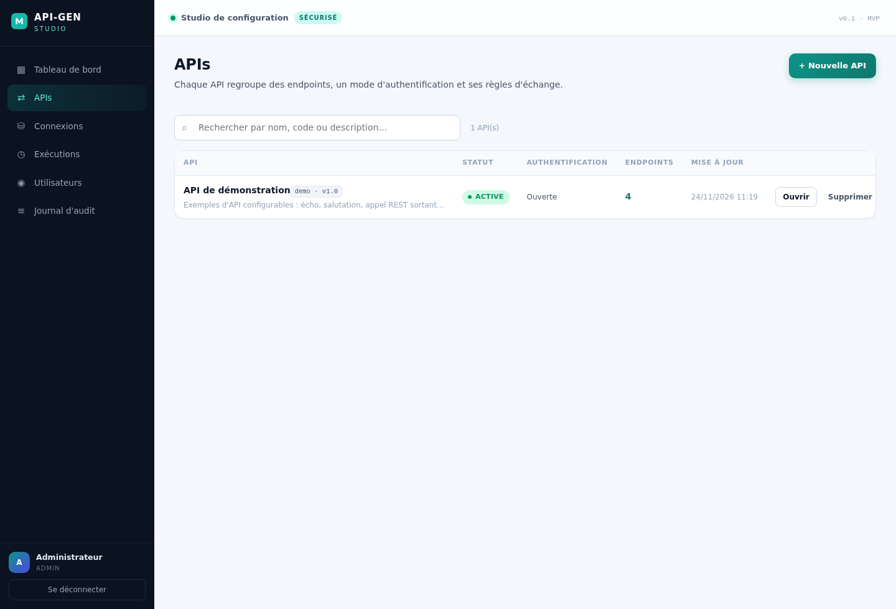 | 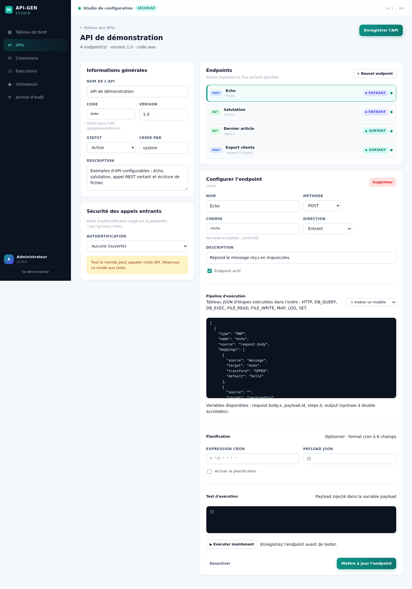 |

| Connexions | Exécutions |
| --- | --- |
|  |  |

| Journal d'audit | Profil & mot de passe |
| --- | --- |
|  | 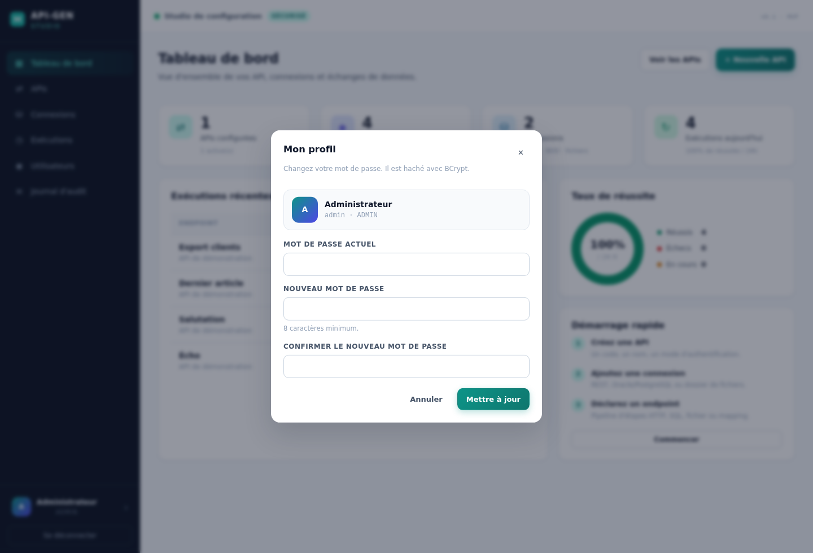 |

| Formulaire de connexion | Test avec latence |
| --- | --- |
|  |  |

| Explorateur de schémas | Génération d'étape depuis une table |
| --- | --- |
|  | 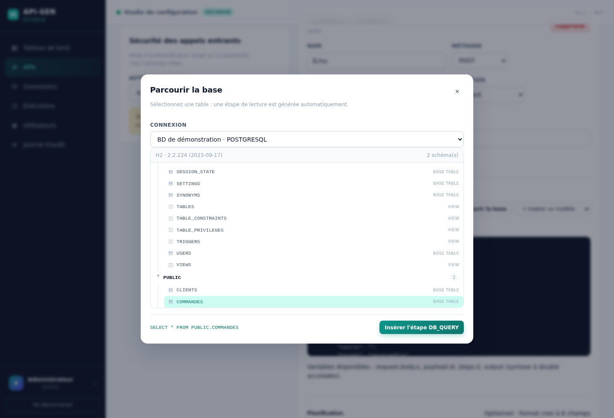 |

| Configuration externe | Paramètres modifiés avant enregistrement |
| --- | --- |
| 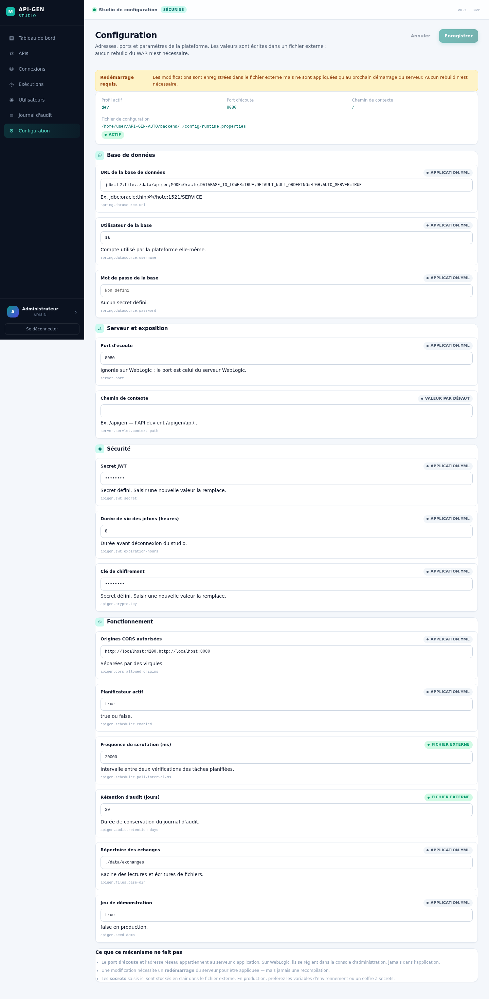 | 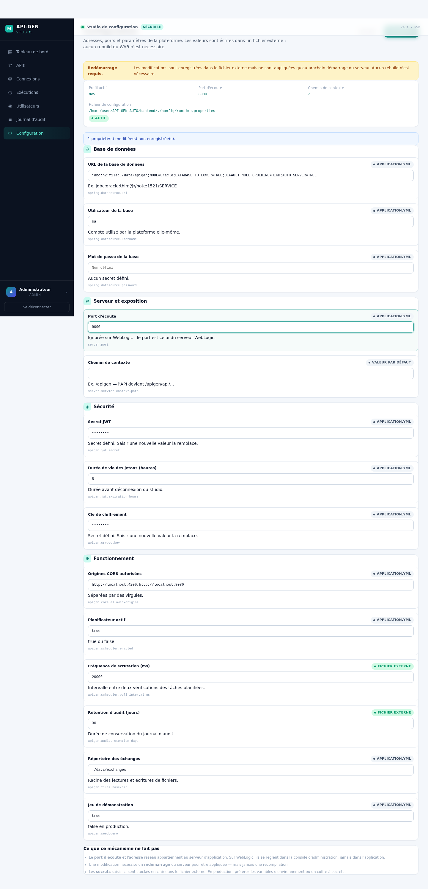 |

| Organisations | APIs groupées par organisation |
| --- | --- |
| 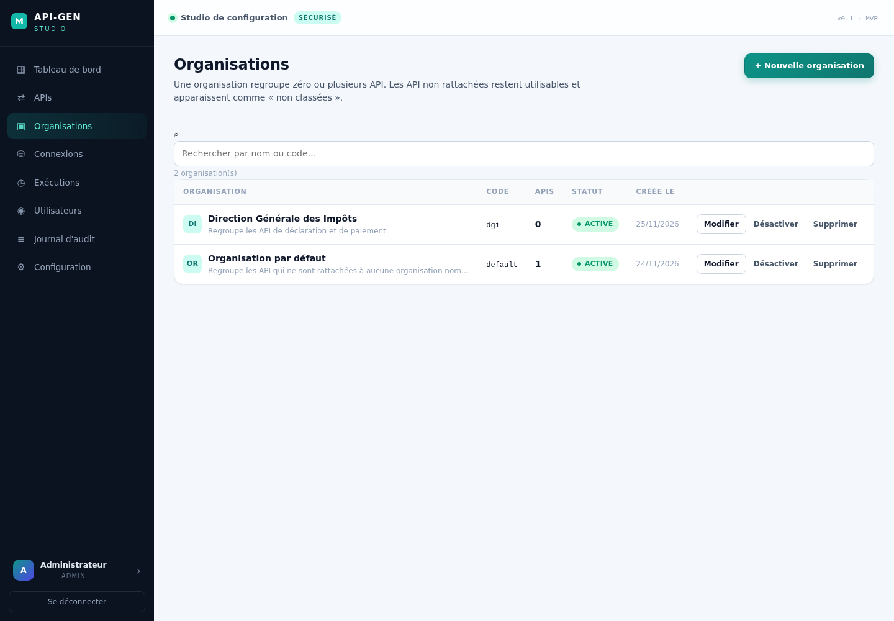 | 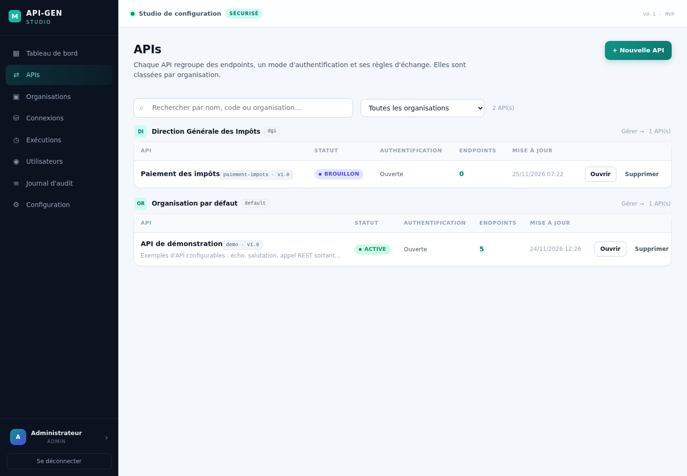 |

| Connexion JDBC : propriétés du pilote | |
| --- | --- |
| 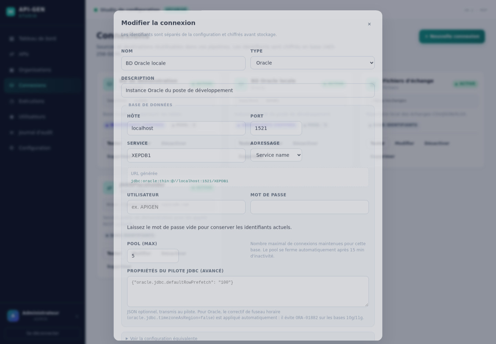 | |

---

## Fonctionnalités du MVP

### Studio d'administration
- Tableau de bord : volumes, taux de réussite, exécutions récentes.
- CRUD complet des **APIs**, **endpoints**, **connexions** et **utilisateurs**.
- Assistant de configuration : informations générales, sécurité, endpoints, pipeline, planification, test.
- **Explorateur de base** : schémas → tables → colonnes (nom, type, nullabilité), sans écrire de SQL.
- **Constructeur de requête** : choisir plusieurs tables, cocher les colonnes, leur donner un alias, définir les jointures, puis ajouter l'étape `DB_QUERY` générée au pipeline.
- Journal des **exécutions** avec requête, réponse, erreur, durée, déclencheur.
- **Journal d'audit** des actions de configuration et de sécurité.
- **Organisations** : chaque API est rattachée à une organisation — une organisation possède
  zéro ou plusieurs API et **son propre contexte de configuration** (variables, secrets chiffrés,
  surcharges `rest.baseUrl` / `files.baseDir`). Liste des API groupée par organisation, filtre par
  organisation, sélecteur dans le formulaire d'API, API « non classées » conservées.
- **Écran de configuration** : adresses, ports, secrets et paramètres de fonctionnement éditables
  sans rebuild, écrits dans un fichier de propriétés externe lu au démarrage.
- Gestion des rôles : `ADMIN`, `EDITOR`, `VIEWER`.

### Moteur d'exécution
- Endpoints **INBOUND** exposés par une passerelle dynamique : `/{code-organisation}/api/gateway/{code-api}{chemin}`.
- Endpoints **OUTBOUND** exécutables manuellement ou planifiés avec des fréquences prêtes à l’emploi (cron 6 champs en mode avancé).
- Entrée : **JSON, XML, texte, formulaire, multipart (fichiers) et binaire** détectés par `Content-Type`.
- Sortie : **JSON, texte, XML, fichier téléchargeable, binaire et redirection 302**, configurable par endpoint.
- Pipelines JSON composés d'étapes ordonnées :
  - `HTTP` / `REST` : appels sortants (GET, POST, PUT, PATCH, DELETE) avec auth Basic, Bearer ou API key.
  - `DB_QUERY` : lecture Oracle, PostgreSQL, MySQL, SQL Server (JDBC).
  - `DB_EXEC` : écriture / mise à jour / procédure.
  - `FILE_READ` / `FILE_WRITE` : CSV, JSON, XLSX (système de fichiers local, protection contre le path traversal).
  - `MAP` : mapping de champs avec transformations (`UPPER`, `LOWER`, `TRIM`, `TO_INT`, `TO_DOUBLE`, `TO_BOOLEAN`, `CONCAT`, `DATE_FORMAT`…).
  - `SET` et `LOG` pour les variables et la traçabilité.
- Templates `{{chemin.dotted}}` : `request.body.client`, `request.query.id`, `payload`, `steps.0`, `output`, `org.code`, `org.variables.*`, `org.secrets.*`.
- Journalisation de chaque exécution avec résumé de requête/réponse et durée.

### Sécurité
- Authentification **JWT** pour le studio (expiration configurable, BCrypt pour les mots de passe).
- **Clés API** par API (header `X-API-Key`), stockées uniquement sous forme de hash SHA-256.
- Mode **JWT** pour les endpoints entrants.
- Identifiants des connexions **chiffrés en base** (AES-256-GCM) et jamais renvoyés par l'API.
- RBAC sur les endpoints d'administration, CORS configurable, headers de sécurité.
- Journal d'audit horodaté (acteur, action, entité, détail).

---

## Architecture

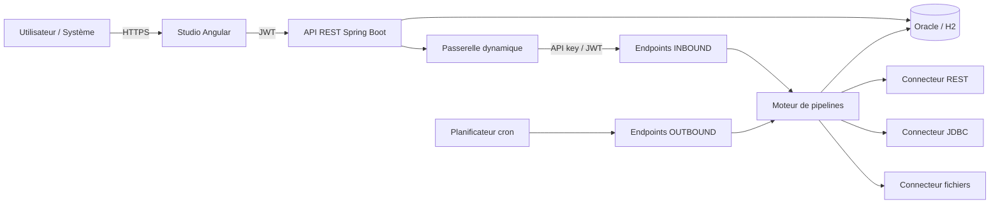

**Stack**

| Couche | Techno |
| --- | --- |
| Backend | Java 17, Spring Boot 3.3, Spring Security, Spring Data JPA |
| Frontend | Angular 17 (standalone, signals), TypeScript 5.4, SCSS |
| Base | Oracle 12c+ (prod) / H2 en mode Oracle (dev) |
| Migrations | Flyway |
| Chiffrement | AES-256-GCM (identifiants), BCrypt (mots de passe), SHA-256 (clés API) |
| JWT | jjwt 0.12 |
| Fichiers | OpenCSV, Apache POI |
| Docs API | springdoc-openapi (Swagger UI) |

### Structure

```
API-GEN-AUTO/
├── backend/                    # Spring Boot
│   ├── src/main/java/com/apigen/
│   │   ├── config/             # sécurité, scheduling, seed
│   │   ├── domain/             # entités JPA
│   │   ├── repository/
│   │   ├── service/            # CRUD + moteur d'exécution
│   │   │   └── connector/      # REST, JDBC, fichiers
│   │   ├── execution/          # contexte, templates, étapes
│   │   ├── web/                # contrôleurs + passerelle
│   │   └── dto/
│   ├── src/main/resources/db/migration/V1__init.sql
│   └── Dockerfile
├── frontend/                   # Angular
│   ├── src/app/core/           # services, guards, interceptors
│   ├── src/app/features/       # login, dashboard, apis, connexions, runs…
│   ├── src/app/shell/
│   ├── nginx.conf
│   └── Dockerfile
├── docs/screenshots/
├── .github/workflows/ci.yml
├── docker-compose.yml
└── Makefile
```

---

## Démarrage rapide (développement)

### Prérequis
- Java 17+
- Maven 3.9+
- Node.js 20+ et npm

### 1. Backend (H2, zéro configuration)

Le profil `local` embarque une base H2 : aucune installation n'est nécessaire pour découvrir
la plateforme. Les profils `dev` et `prod` ciblent Oracle 12c (voir plus bas).

```bash
cd backend
mvn spring-boot:run -Dspring-boot.run.profiles=local
```

- API : `http://localhost:8080`
- Swagger : `http://localhost:8080/swagger-ui.html`
- Console H2 : `http://localhost:8080/h2-console` (profil `local` uniquement)
- Compte admin créé au premier démarrage : **admin / Admin2026!**

### 2. Frontend

```bash
cd frontend
npm install
npm start
```

Studio : `http://localhost:4200` (le proxy Angular redirige `/api/` vers `http://localhost:8080`).

### 3. Utiliser la démonstration

Le profil `local` crée une organisation de code `default` et une API `demo` avec quatre endpoints :

| Méthode | Chemin | Rôle |
| --- | --- | --- |
| `POST` | `/default/api/gateway/demo/echo` | Répond le message reçu en majuscules |
| `GET` | `/default/api/gateway/demo/hello?name=Amina` | Salutation avec mapping |
| `GET` | `/default/api/gateway/demo/posts` | Appel REST sortant + mapping (JSONPlaceholder) |
| `POST` | `/default/api/gateway/demo/export/clients` | Écriture CSV |

Exemple :

```bash
curl -X POST http://localhost:8080/default/api/gateway/demo/echo \
  -H "Content-Type: application/json" \
  -d '{"message":"bonjour"}'
```

```json
{"runId":1,"correlationId":"bd69b4cd","status":"SUCCESS","data":{"echo":"BONJOUR","receivedVia":"POST"}}
```

Dans le studio, le JSON saisi dans **Payload JSON** est injecté à la fois dans `payload` et dans
`request.body` (avec `request.query` si le payload contient une clé `query`). Les endpoints entrants
de la démo se testent donc sans passer par la passerelle. L'endpoint « Dernier article » tente un
appel réel mais retombe sur des valeurs de démonstration si Internet n'est pas accessible.

---

## Se connecter à votre Oracle local

Le studio peut dialogiquer avec n'importe quelle base Oracle accessible depuis la machine qui exécute le backend — y compris celle installée sur votre poste de développement. Rien à changer dans la configuration Spring : tout se fait dans l'interface.

### 1. Vérifier que l'instance écoute

```bash
lsnrctl status
```

Repérez le **service name** déclaré (par exemple `FREEPDB1` sur Oracle Free 23ai, `XEPDB1` sur XE 21c, `orcl` sur une instance non-multitenant). Si le listener n'est pas démarré :

```bash
lsnrctl start
```

### 2. Créer un utilisateur dédié

Avec SQL*Plus (ou SQL Developer) en `SYSDBA` :

```sql
-- Si l'instance est multitenant, se placer dans le PDB
ALTER SESSION SET CONTAINER = FREEPDB1;

CREATE USER APIGEN IDENTIFIED BY "ChangeMe_2026" QUOTA UNLIMITED ON USERS;
GRANT CONNECT, RESOURCE, CREATE VIEW, CREATE TABLE TO APIGEN;
```

Contrôle depuis un terminal :

```bash
sqlplus APIGEN/ChangeMe_2026@//localhost:1521/FREEPDB1
```

Si cette commande échoue, le studio échouera de la même manière : corrigez d'abord ici.

### 3. Déclarer la connexion dans le studio

**Connexions → Nouvelle connexion**, puis :

| Champ | Valeur |
| --- | --- |
| Type | `Oracle` |
| Hôte | `localhost` |
| Port | `1521` |
| Service | `FREEPDB1` (ou `XEPDB1`, `orcl`…) |
| Adressage | `Service name` (ou `SID` pour les instances anciennes) |
| Utilisateur | `APIGEN` |
| Mot de passe | votre mot de passe |
| Pool (max) | `5` |

L'URL générée s'affiche en aperçu :

```
jdbc:oracle:thin:@//localhost:1521/FREEPDB1
```

Cliquez **« Tester la connexion »** : le résultat s'affiche avec la latence mesurée. Enregistrez ensuite.

### 4. L'utiliser dans un pipeline

Deux façons :

**Sans écrire de SQL** — dans l'éditeur d'API, cliquez sur **« ⊞ Parcourir la base »** au-dessus du pipeline. Choisissez la connexion, dépliez les schémas, cochez une ou plusieurs tables puis les colonnes voulues. Le champ à droite de chaque colonne est son alias (nom du champ en sortie). Si vous avez choisi plusieurs tables, renseignez les jointures proposées (`t1.ID = t2.ID`), vérifiez la requête générée, puis cliquez sur **« Ajouter cette requête au pipeline »**.

**À la main** :

```json
[
  {
    "type": "DB_QUERY",
    "name": "verif",
    "connectionId": 3,
    "sql": "SELECT sysdate AS moment FROM dual"
  }
]
```

`connectionId` est l'identifiant affiché sur la carte de la connexion. L'étape emprunte une connexion au pool, exécute la requête et la rend au pool.

### Erreurs Oracle fréquentes

| Code | Cause | Correctif |
| --- | --- | --- |
| `ORA-12541` | Aucun listener | `lsnrctl start` |
| `ORA-12505` | Le listener ne connaît pas ce SID | Passer l'adressage en `Service name`, ou corriger le SID |
| `ORA-12514` | Service name inconnu | Vérifier le nom avec `lsnrctl status` |
| `ORA-01017` | Identifiants refusés | Recréer l'utilisateur ou vérifier le mot de passe |
| `ORA-28000` | Compte verrouillé | `ALTER USER APIGEN ACCOUNT UNLOCK;` |

---

## Configuration

Copier `.env.example` vers `.env` (ou exporter les variables) :

| Variable | Défaut | Rôle |
| --- | --- | --- |
| `APIGEN_PROFILE` | `dev` | `local` (H2), `dev` (Oracle 12c) ou `prod` (Oracle 12c) |
| `APIGEN_DB_URL` | `jdbc:oracle:thin:@localhost:1521:ORCL` | URL JDBC Oracle (syntaxe SID) |
| `APIGEN_DB_USER` | `APIGEN` | Compte/schéma dédié à la plateforme |
| `APIGEN_DB_PASSWORD` | `APIGEN1234` | Mot de passe initial du compte APIGEN, à changer en production |
| `ORACLE_HOST` / `ORACLE_PORT` / `ORACLE_SID` | `localhost` / `1521` / `ORCL` | Composants de l'URL si `APIGEN_DB_URL` n'est pas fourni |
| `APIGEN_JWT_SECRET` | valeur de dev | **À changer en production** (≥ 64 caractères) |
| `APIGEN_CRYPTO_KEY` | valeur de dev | Clé AES-256 des identifiants (**à changer**) |
| `APIGEN_CORS_ORIGINS` | `http://localhost:4200,http://localhost:8080` | Origines autorisées |
| `APIGEN_SCHEDULER_ENABLED` | `true` | Active le planificateur cron |
| `APIGEN_SCHEDULER_POLL_MS` | `15000` | Fréquence de scrutation |
| `APIGEN_FILES_BASE_DIR` | `./data/exchanges` | Racine des fichiers |
| `APIGEN_SEED_DEMO` | `true` en dev | Crée le jeu de démonstration |
| `APIGEN_ADMIN_PASSWORD` | `Admin2026!` | Mot de passe du premier compte admin (si aucun utilisateur) |
| `APIGEN_SEED_CONNECTIONS_FILE` | `./config/connections.json` | Connexions des pipelines créées au démarrage |
| `APIGEN_JWT_EXPIRATION_HOURS` | `8` | Durée de vie des jetons |
| `APIGEN_JDBC_POOL_EVICT_MS` | `300000` | Fréquence de fermeture des pools inactifs |

Pour un déploiement où l'on ne peut pas encore se connecter au studio : copier
`config/runtime.properties.example` et `config/connections.json.example`, renseigner la base de la
plateforme, les secrets, les CORS et les connexions des pipelines, puis démarrer avec
`APIGEN_PROFILE=prod`. Le profil doit être choisi **avant** le démarrage : il ne peut pas être
modifié dans `runtime.properties`. La base H2 n'est utilisée qu'avec le profil `local` ; aucun
repli silencieux vers H2 n'existe si la base configurée est indisponible.

### Profils et base de données

| Profil | Base | Usage |
| --- | --- | --- |
| `local` | H2 fichier (`./data/apigen`) | Démonstration, tests, démarrage sans Oracle |
| `dev` | **Oracle 12c** — `SID=ORCL`, utilisateur `APIGEN` | Développement |
| `prod` | **Oracle 12c** — `SID=ORCL`, utilisateur `APIGEN` | Production |

`dev` et `prod` partagent la même cible Oracle ; seul le comportement diffère (jeu de
démonstration, console H2, verbosité). L'URL est construite par défaut avec la syntaxe **SID** :

```
jdbc:oracle:thin:@localhost:1521:ORCL
```

Tout est surchargeable sans rebuild via les variables du tableau ci-dessus ou le fichier externe
`config/runtime.properties`.

### Contexte propre à chaque organisation

Chaque organisation porte un contexte éditable dans le studio (menu **Organisations**) :
il est appliqué à toutes les API qui lui sont rattachées et surcharge la configuration globale.
Il ne modifie pas l'URL de la passerelle : le préfixe reste le **code** de l'organisation, précédé
du chemin de contexte global éventuel. Les secrets y sont chiffrés en base (AES-256-GCM) et masqués
à l'écran. Vous pouvez laisser cette section vide : tout le contexte global continue de s'appliquer.

```json
{
  "variables": { "region": "centre", "siret": "12345678900000" },
  "secrets": { "apiToken": "valeur-secrète" },
  "overrides": {
    "rest": { "baseUrl": "https://erp.sigif.cm:8443/api" },
    "files": { "baseDir": "./data/exchanges/dgi" }
  }
}
```

- dans le studio, ce JSON est généré automatiquement depuis les champs **Variables**, **Secrets**,
  **Adresse de base des appels HTTP** et **Dossier des échanges** : aucun JSON à écrire à la main ;
- `variables` et `secrets` sont accessibles aux pipelines via `{{org.variables.region}}` et
  `{{org.secrets.apiToken}}` (URL, header, corps, paramètre SQL…).
- `org.overrides.rest.baseUrl` sert de base aux URLs HTTP **relatives** lorsqu'aucune connexion
  REST n'est définie dans l'étape ; une connexion explicite reste prioritaire.
- `org.overrides.files.baseDir` remplace `APIGEN_FILES_BASE_DIR` pour les étapes `FILE_*` sans
  connexion fichier explicite.
- Les API non classées utilisent un contexte vide.

### Bases cibles : Oracle 10g, 11g, 12c, 19c, PostgreSQL, MySQL, SQL Server…

Les connexions JDBC passent par un pool HikariCP propre à chaque base cible, et les propriétés
du pilote sont construites automatiquement selon l'URL. Deux règles :

- **toute URL Oracle** reçoit `oracle.jdbc.timezoneAsRegion=false` ;
- `oracle.jdbc.languageMap` / `oracle.jdbc.territoryMap` traduisent le Locale de la JVM vers
  `AMERICAN_AMERICA`, pour éviter `ORA-12705` sur les bases anciennes ;
- une base non-Oracle ne reçoit aucune propriété parasite.

Le point Oracle est important : par défaut le pilote envoie le **nom** de la région de la JVM
(par exemple `Africa/Douala`). Une base dont le fichier de fuseaux ne connaît pas cette région
répond alors `ORA-01882: timezone region not found` (ou `ORA-00604` au niveau SQL récursif) —
c'est systématique sur les 10g/11g. En demandant un décalage numérique, la connexion passe sur
toutes les versions.

Pour aller plus loin (préfetch, NLS, chiffrement du transport…), chaque connexion expose un
champ **Propriétés du pilote JDBC** (JSON) dans le formulaire, stocké dans
`baseConfig.driverProperties` :

```json
{ "oracle.jdbc.defaultRowPrefetch": "100", "oracle.jdbc.oracleLogTraceLevel": "16" }
```

Les valeurs saisies **priment** sur les valeurs par défaut, ce qui permet de désactiver le
correctif si une base l'exigeait :

```json
{ "oracle.jdbc.timezoneAsRegion": "true" }
```

### Création automatique des tables manquantes

Au démarrage, après les migrations Flyway, un garde-fou (`SchemaGuard`) vérifie que les huit
tables de la plateforme existent et **crée celles qui manquent**, avec leurs index et leurs
contraintes :

```
organizations · api_definitions · endpoints · connections · schedules · exchange_runs · app_users · audit_events
```

Concrètement : si `app_users` (la table des utilisateurs de l'application) a été supprimée, elle
est recréée au démarrage suivant et le compte `admin` est rétabli. Aucune intervention manuelle,
aucun script SQL à rejouer.

Deux réglages complémentaires :

- `spring.flyway.baseline-on-migrate=true` avec `baseline-version=0` : sur un schéma Oracle qui
  contient déjà d'autres tables, Flyway pose un référentiel puis applique les migrations au lieu
  d'échouer sur « schéma non vide sans historique » ;
- si l'historique Flyway a été perdu, les migrations sont rejouées depuis le début — les tables
  déjà présentes sont conservées et seules les manquantes sont créées par le garde-fou.

### Configuration externe : changer les paramètres sans rebuild

Les valeurs de la table ci-dessus sont figées dans le livrable. Pour les modifier **après**
déploiement (WAR/EAR déjà construit), la plateforme lit un fichier de propriétés externe au
démarrage :

```
config/runtime.properties     # chemin par défaut, à côté du répertoire de lancement
```

Ordre de priorité appliqué :

```
ligne de commande  >  config/runtime.properties  >  variables d'environnement  >  application.yml
```

Le chemin se change avec `APIGEN_RUNTIME_CONFIG` (ou `--apigen.runtime-config=`) : placez le
fichier hors du WAR, sur un répertoire monté en volume, il survit aux redéploiements.

Deux façons de le renseigner :

1. **Depuis le studio** — menu *Configuration* (rôle `ADMIN`). L'écran liste les 14 propriétés
   éditables, indique pour chacune sa source réelle (`application.yml`, *Fichier externe`,
   variable d'environnement, valeur par défaut) et écrit le fichier en un clic.
2. **Par l'API** — `GET /api/config` renvoie l'état, `PUT /api/config` écrit :

```json
{ "values": { "server.port": "9090", "apigen.audit.retention-days": "30" } }
```

Réponse : `{ "changed": [...], "ignored": [...], "writtenTo": "...", "restartRequired": true }`.
Une clé inconnue est renvoyée dans `ignored` ; une valeur vide supprime la ligne ; un secret
laissé tel quel (`••••••••`) n'est pas réécrit.

Les valeurs s'appliquent **au redémarrage suivant** du serveur — jamais de recompilation ni de
repackaging. Deux limites à connaître :

- le **port d'écoute** et l'adresse réseau appartiennent au serveur d'application, pas au WAR.
  Sur WebLogic ils se règlent dans la console d'administration (voir ci-dessous) ;
- les secrets saisis ici sont écrits **en clair** dans le fichier. En production, préférez les
  variables d'environnement ou un coffre à secrets.

#### Studio et backend sur deux serveurs différents

L'adresse du backend utilisée par le studio se règle dans `config.json`, à côté des fichiers
statiques du frontend (`frontend/public/config.json` dans les sources). **Aucun rebuild** n'est
nécessaire : modifiez le fichier déployé, puis rechargez la page.

```json
{ "backendUrl": "http://serveur-backend:8081", "contextPath": "/apigen" }
```

Laissez `backendUrl` vide pour conserver le comportement « même serveur » (proxy Angular en
développement, nginx en production). Si le chemin de contexte est déjà inclus dans `backendUrl`,
ne le répétez pas dans `contextPath`. Autorisez ensuite l'origine du studio sur le backend avec
`APIGEN_CORS_ORIGINS=http://studio.example.com`. L'adresse effective est visible dans le studio,
menu **Configuration**. Sans accès au fichier, l'écran de connexion permet de la saisir dans
**Paramètres de connexion (avancé)** : le réglage est mémorisé dans le navigateur et peut être
réinitialisé.

En développement : `APIGEN_BACKEND=http://serveur-backend:8081 npm start`.

Avec Docker : `BACKEND_URL=http://serveur-backend:8081 CONTEXT_PATH=/apigen docker compose up -d`.

### Déploiement de production (Tomcat + frontend statique)

Le backend est livré en **WAR** (`backend/target/apigen-platform.war`) pour Tomcat **10.1+**. Le
frontend est un dossier statique à déployer dans WebLogic ou Apache/XAMPP/WAMP. La procédure
complète (fichiers à remplir, `setenv.sh`, `config.json`, CORS, checklist) est dans
[`DEPLOY-PROD.md`](DEPLOY-PROD.md). Le profil reste `dev` par défaut dans le code : la production
doit définir `APIGEN_PROFILE=prod` avant le démarrage.

### Déploiement sur serveur d'application (WebLogic)

Le livrable Spring Boot 3.3 / Jakarta EE 9+ **ne se déploie pas tel quel sur WebLogic 12c** :

| Version WebLogic | Spécifications | Spring Boot 3.3 |
| --- | --- | --- |
| 12c (12.2.1.x) | Java EE 7, JDK 8 | ❌ incompatible (`javax.*`, pas de `jakarta.*`) |
| 14.1.2 | Jakarta EE 8 | ❌ toujours incompatible |
| 15.1.1 | Jakarta EE 9.1, JDK 17/21 | ✅ compatible |

Trois voies possibles :

- **Monter vers WebLogic 15.1.1** — aucune modification du code ; déployer le WAR produit par
  Spring Boot (ou l'EAR) et paramétrer le port et le contexte dans la console.
- **Rester sur 12c** — rétrograder la plateforme vers Spring Boot 2.7.18 (`javax.*`, JDK 8) :
  refonte majeure, à chiffrer séparément.
- **Contourner** — exposer l'application en JAR exécutable derrière un WebLogic frontal ou un
  reverse proxy, si la contrainte porte sur le domaine et non sur le conteneur.

Dans tous les cas, adresses et ports se règlent dans le fichier externe ci-dessus, sans rebuild.

### Production avec Oracle 12c

La base de production est déjà décrite dans les profils : `SID=ORCL`, utilisateur `APIGEN`.
Créer d’abord le schéma dédié et fournir son mot de passe avant de lancer en profil `prod` :

```bash
export APIGEN_PROFILE=prod
export APIGEN_DB_USER=APIGEN
export APIGEN_DB_PASSWORD="APIGEN1234"
export APIGEN_JWT_SECRET="$(openssl rand -hex 48)"
export APIGEN_CRYPTO_KEY="$(openssl rand -base64 32)"
java -jar backend/target/apigen-platform.war
```

Pour pointer ailleurs (autre hôte, autre SID, autre service) :

```bash
# syntaxe SID
export APIGEN_DB_URL="jdbc:oracle:thin:@db-host:1521:ORCL"
# syntaxe service-name (pluggable database)
export APIGEN_DB_URL="jdbc:oracle:thin:@//db-host:1521/FREEPDB1"
```

1. Faire créer le compte/schéma APIGEN par le DBA avec
   `database/oracle/create-apigen-schema.sql` : voir [SCHEMA-ORACLE.md](SCHEMA-ORACLE.md).
2. Configurer le mot de passe du compte APIGEN. Flyway crée les tables de la
   plateforme et son historique dans ce schéma, mais pas le compte Oracle lui-même.

**Changer le compte JDBC ne déplace pas les données existantes dans SIGIF.**
Lire le guide de schéma avant de migrer une installation existante.

---

## Concepts

### Organisation
Un périmètre (direction, ministère, partenaire) qui regroupe zéro ou plusieurs API et porte leur
**contexte propre** : variables, secrets chiffrés et surcharges de configuration (voir ci-dessus).
Le code de l'organisation préfixe l'URL de la passerelle ; les API non classées utilisent `default`.
Le code d'une API n'est unique **que dans son organisation** (`ux_api_code_org`).

### API
Un conteneur logique : **code unique dans son organisation**, nom, version, statut (`DRAFT`, `ACTIVE`, `PAUSED`, `ARCHIVED`), mode d'authentification entrant (`NONE`, `API_KEY`, `JWT`). Deux organisations peuvent donc déclarer une API portant le même code ; la passerelle les distingue par le code d'organisation.

### Endpoint
Une route exposée (INBOUND) ou un flux sortant (OUTBOUND) :

- `method` + `path` (variables `{id}` acceptées),
- `pipeline` : tableau JSON d'étapes,
- `active` : interrupteur sans suppression,
- `schedule` : cron optionnel + payload JSON.
- `responseFormat` : `JSON` (défaut), `TEXT`, `XML`, `FILE`, `BINARY` ou `REDIRECT`, avec
  `responseFileName`, `responseContentType` et `redirectLocation` optionnels.

### Connexion
Une source ou destination réutilisée : REST, Oracle, PostgreSQL, MySQL, SQL Server, fichiers, FTP/SFTP (connecteurs FTP/SFTP à venir).

- `baseConfig` : JSON non sensible (`baseUrl`, `jdbcUrl`, `host`, `port`, `database`, `basePath`, `authType`…).
- `credentials` : JSON chiffré en base (`username`, `password`, `token`, `apiKey`).

Le formulaire du studio **n'exige pas d'écrire de JSON** : choisissez le type, saisissez l'hôte, le port et le service, l'URL JDBC est générée et affichée en aperçu. Les champs `host` / `port` / `database` sont enregistrés en plus de `jdbcUrl` pour que le formulaire se raffiche correctement en édition.

**Test de connexion** : le bouton « Tester la connexion » ouvre une connexion réelle et affiche le résultat avec la **latence mesurée** (< 300 ms en vert, < 1 s en orange, au-delà en rouge). Une base injoignable répond en quelques centaines de millisecondes avec le message exact du pilote JDBC (`Connection refused`, `ORA-12505`, …).

**Pool de connexions** : chaque connexion de type base de données dispose de son propre pool HikariCP, dimensionné par le champ « Pool (max) » (1 à 20, 5 par défaut). Le pool est recréé automatiquement quand l'URL ou les identifiants changent, et fermé après **15 minutes d'inactivité**. L'exécution d'une étape `DB_QUERY` réutilise ainsi une connexion déjà établie au lieu d'ouvrir une nouvelle connexion à chaque appel — sur Oracle, cela évite un handshake réseau complet par exécution.

**Découverte de la structure** : le bouton « Découvrir les tables » liste les schémas, puis les tables et vues de chaque schéma, puis les colonnes d'une table sélectionnée (nom, type, `NOT NULL`). L'explorateur est aussi disponible depuis l'éditeur d'API via « ⊞ Parcourir la base » : le mode construction permet de choisir plusieurs tables, des colonnes avec alias et des jointures, puis génère une étape `DB_QUERY` complète avec le bon `connectionId`.

Les requêtes de métadonnées sont écrites par dialecte : `all_users` / `all_tables` / `all_tab_columns` côté Oracle (en écartant les schémas maintenus par Oracle via `oracle_maintained = 'N'`), `information_schema` pour PostgreSQL, MySQL et SQL Server. Sur **Oracle 11g**, où `ORACLE_MAINTAINED` n'existe pas, une liste d'exclusion explicite prend le relais. Un schéma illisible — faute de droits — est silencieusement omis plutôt que de faire échouer toute la découverte.

### Pipeline

```json
[
  {
    "type": "HTTP",
    "name": "appel-crm",
    "method": "GET",
    "url": "/customers/{{payload.id}}",
    "connectionId": 1,
    "headers": { "Accept": "application/json" },
    "failOnError": true
  },
  {
    "type": "MAP",
    "name": "mapping",
    "source": "output.body",
    "mappings": [
      { "source": "nom", "target": "customer.name", "transform": "UPPER" },
      { "source": "email", "target": "customer.email", "transform": "LOWER" }
    ]
  },
  {
    "type": "DB_EXEC",
    "name": "sauvegarde",
    "connectionId": 2,
    "sql": "INSERT INTO customers (name, email) VALUES (?, ?)",
    "params": ["{{output.name}}", "{{output.email}}"]
  }
]
```

#### Types d'étapes

| Type | Champs principaux |
| --- | --- |
| `HTTP` | `method`, `url`, `connectionId`, `headers`, `body`/`bodyTemplate`, `queryParams`, `timeoutMs`, `failOnError` |
| `DB_QUERY` | `connectionId`, `sql`, `params`, `maxRows`, `timeoutSeconds` |
| `DB_EXEC` | `connectionId`, `sql`, `params`, `timeoutSeconds` |
| `FILE_READ` | `connectionId`, `path`, `format` (`CSV`, `JSON`, `XLSX`) |
| `FILE_WRITE` | `connectionId`, `path`, `format`, `data` |
| `MAP` | `source`, `mappings[] {source,target,transform,default,params}`, `mode` (`REPLACE`/`MERGE`) |
| `SET` | `key`, `value` |
| `LOG` | `message` |

#### Transformations disponibles
`UPPER`, `LOWER`, `TRIM`, `TO_STRING`, `TO_INT`, `TO_LONG`, `TO_DOUBLE`, `TO_BOOLEAN`, `CONCAT` (avec `params.prefix` / `params.suffix`), `DATE_FORMAT` (avec `params.pattern`).

#### Variables
- `request.body`, `request.query`, `request.headers`, `request.pathVariables`
- `payload` (exécution manuelle ou planifiée)
- `steps.<nom>` ou `steps.<index>` (résultat d'une étape)
- `output` (dernier résultat)
- `trigger`, `vars`
- `org.code`, `org.variables`, `org.secrets`, `org.overrides` (contexte de l'organisation)
- `request.rawBody`, `request.files.<nom>.{filename,contentType,size,base64}`, `request.link`, `request.binary`

#### Formats d'entrée et de sortie

**Entrée** — la passerelle analyse le corps selon le `Content-Type` :

| Content-Type | `request.body` |
|---|---|
| `application/json` | objet/listier JSON |
| `application/xml`, `text/xml` | objet JSON issu du XML (`request.body.client.nom`) |
| `text/plain` | chaîne (et `request.link` si c'est une URL) |
| `application/x-www-form-urlencoded` | objet clé/valeur |
| `multipart/form-data` | `{fields, files}` ; chaque fichier expose `base64`, `filename`, `contentType`, `size` |
| autre (octet-stream, image…) | chaîne **base64** + `request.binary=true`, `request.size` |

Un paramètre de requête `url=...` alimente aussi `request.link`.

**Sortie** — le format est configuré sur l'endpoint (rubrique « Réponse de la passerelle ») :

| Format | Réponse |
|---|---|
| `JSON` | enveloppe `{runId, correlationId, status, data}` (comportement historique) |
| `TEXT` | `text/plain` avec le résultat du pipeline |
| `XML` | `application/xml`, racine `<response>` (ou XML déjà produit par le pipeline) |
| `FILE` | fichier créé par `FILE_WRITE`, téléchargé en pièce jointe (`path` lu dans le résultat) |
| `BINARY` | octets décodés depuis un champ `base64`/`content`/`data` du résultat (une étape `SET` avec `{{request.body}}` permet de renvoyer un binaire reçu) |
| `REDIRECT` | `302 Location` (champ `redirectLocation`, `{runId}` accepté) |

Pour les formats non-JSON, `X-Run-Id` et `X-Correlation-Id` sont renvoyés dans les en-têtes ;
les échecs d'exécution restent une réponse JSON `502`.

---

## API REST de gestion

Toutes les routes `/api/**` (sauf `/api/auth/login`) nécessitent un `Authorization: Bearer <JWT>`. Les routes de passerelle `/{code-organisation}/api/gateway/**` sont publiques et authentifiées selon le mode de l'API.

| Méthode | Route | Rôle |
| --- | --- | --- |
| `POST` | `/api/auth/login` | Connexion |
| `GET` | `/api/auth/me` | Utilisateur courant |
| `POST` | `/api/auth/change-password` | Changer son mot de passe |
| `GET/POST` | `/api/organizations` | Lister / créer des organisations |
| `GET/PUT/DELETE` | `/api/organizations/{id}` | Détail / mise à jour / suppression (`ADMIN`) |
| `GET/POST` | `/api/apis` | Lister / créer des APIs |
| `GET/PUT/DELETE` | `/api/apis/{id}` | Détail / mise à jour / suppression |
| `POST` | `/api/apis/{id}/api-key` | Générer / régénérer une clé |
| `DELETE` | `/api/apis/{id}/api-key` | Révoquer la clé |
| `POST` | `/api/apis/{id}/endpoints` | Créer un endpoint |
| `GET/PUT/DELETE` | `/api/endpoints/{id}` | Détail / mise à jour / suppression |
| `PATCH` | `/api/endpoints/{id}/active?active=true` | Activer / désactiver |
| `PUT` | `/api/endpoints/{id}/schedule` | Créer / mettre à jour la planification |
| `DELETE` | `/api/endpoints/{id}/schedule` | Supprimer la planification |
| `POST` | `/api/endpoints/{id}/run` | Exécution manuelle |
| `GET/POST` | `/api/connections` | Lister / créer des connexions |
| `GET/PUT/DELETE` | `/api/connections/{id}` | Détail / mise à jour / suppression |
| `POST` | `/api/connections/test` | Tester une configuration non enregistrée |
| `POST` | `/api/connections/{id}/test` | Tester une connexion enregistrée |
| `POST` | `/api/connections/discover` | Lister schémas et tables (connexion enregistrée ou inline) |
| `POST` | `/api/connections/discover/columns` | Lister les colonnes d'une table |
| `GET` | `/api/runs?apiId=&status=&page=&size=` | Journal des exécutions |
| `GET` | `/api/runs/{id}` | Détail d'une exécution |
| `GET` | `/api/dashboard` | Statistiques |
| `GET` | `/api/users` | Utilisateurs (`ADMIN`) |
| `GET` | `/api/audit` | Journal d'audit |

### Passerelle dynamique

```http
POST /{code-organisation}/api/gateway/{code-api}/{chemin}
X-API-Key: agk_...
Content-Type: application/json
```

Le code d'organisation est le **préfixe de contexte** de l'URL : l'API est résolue dans cette
organisation. Les API non classées restent accessibles sous le préfixe réservé `default`. Les
formes `/api/gateway/{code-api}/...` et `/api/gateway/{code-organisation}/{code-api}/...` ne sont
plus acceptées. Si un `server.servlet.context-path` global est défini, il s'ajoute avant le préfixe
(ex. `/apigen/dgi/api/gateway/clients/...`). Le proxy du studio (`frontend/proxy.conf.js`) lit ce
même chemin dans `config/runtime.properties` : après avoir enregistré `/apigen` dans **Configuration**
et redémarré le backend, rechargez le studio, la connexion fonctionne sans changer l'URL du frontend.

La réponse contient toujours `runId`, `correlationId`, `status` et `data` (ou `error`).

---

## Tests

```bash
cd backend
mvn test
```

Les tests couvrent : démarrage du contexte, login JWT, protection des routes, passerelle dynamique, mapping, génération et validation d'une clé API.

---

## Docker

```bash
docker compose up --build
```

- Oracle Free : `db:1521`
- Backend : `http://localhost:8080`
- Studio : `http://localhost:4200`

Les secrets par défaut du `docker-compose.yml` sont des valeurs de démonstration : **remplacez-les** (`APIGEN_JWT_SECRET`, `APIGEN_CRYPTO_KEY`, mot de passe Oracle).

---

## Limites connues & feuille de route

- Connecteurs **FTP/SFTP** déclarés dans le modèle mais non implémentés (priorité suivante).
- La découverte de structure couvre **Oracle, PostgreSQL, MySQL et SQL Server** uniquement ; elle ne parcourt pas le réseau à la recherche de serveurs (aucun scan de ports).
- Planificateur conçu pour une **instance unique** ; prévoir ShedLock ou une table de verrous pour le multi-instances.
- Les **pools JDBC sont locaux à chaque instance** (pas de pool distribué). En cluster, chaque nœud maintient son propre pool par base cible.
- Pas de **rate limiting** ni de quota par clé API.
- Pas de **versioning** des pipelines ni de rollback.
- La configuration externe s'applique **au redémarrage** : pas de rechargement à chaud.
- **WebLogic 12c non supporté** (Java EE 7 / `javax.*`) : Spring Boot 3.3 exige Jakarta EE 9+.
  Cible compatible : WebLogic 15.1.1. Voir « Déploiement sur serveur d'application ».
- Studio : le pipeline reste un **éditeur JSON** (les connexions, elles, sont en champs structurés) ; un concepteur visuel par glisser-déposer est envisagé.
- Pas de **chiffrement applicatif** des réponses stockées (seuls les identifiants sont chiffrés).
- L'authentification OAuth2/OIDC côté endpoints entrants est à ajouter.
- Tests de charge et durcissement production (Helmet, CSP, rotation des clés) à compléter.

---

## Licence

Projet interne — à adapter selon la politique de votre entreprise.

## Authentification consommateurs par système (nouveau modèle)

La passerelle exige maintenant un token consommateur opaque de 24 h maximum,
limité à l’organisation et aux API autorisées du système. Les anciens modes
`NONE` / `API_KEY` / JWT Studio ne permettent plus de contourner ce contrôle.
Leurs mentions dans les anciens exemples ci-dessus sont historiques.

Le menu **Accès consommateurs** gère les profils locaux ou à pipeline SQL/HTTP,
leurs API autorisées, les consommateurs locaux et les révocations de sessions.
Chaque organisation reçoit un profil `default` désactivé. Les applications
consommatrices n’ont pas de compte Studio. Le renouvellement rotatif est limité
à 7 jours par connexion initiale.

**Avant déploiement : lire [AUTH-CONSOMMATEURS.md](AUTH-CONSOMMATEURS.md)**,
notamment la procédure de migration et les contraintes des systèmes externes.
L’éditeur d’endpoint propose également **Utiliser une information reçue** pour
transmettre les paramètres déclarés à une étape SQL, HTTP ou SET.
